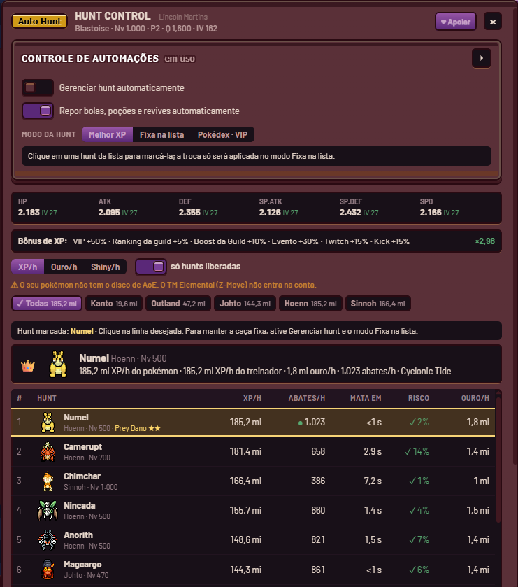
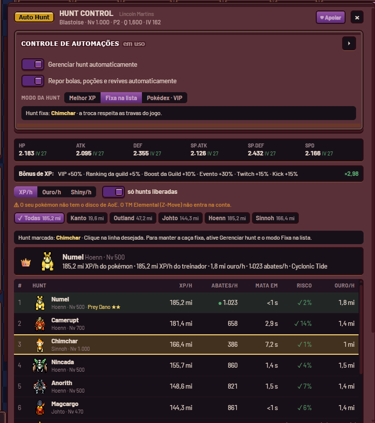
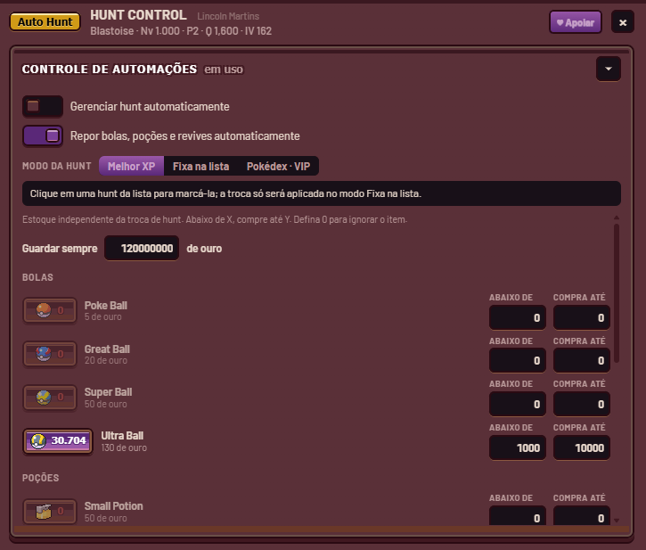
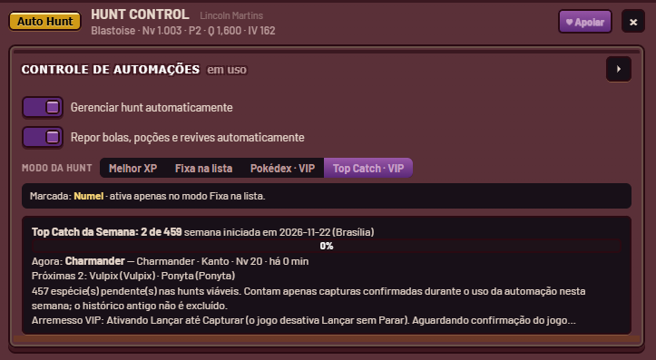

# Hunt Control for PokeIdle

**Analise hunts, escolha sua rota e gerencie caçadas com mais controle no [PokeIdle.io](https://pokeidle.io/).**

**Desenvolvedor:** Lincoln Martins  
**Versão:** `0.1.9` · **Plataforma:** Google Chrome (Manifest V3) · **Idioma:** Português (Brasil)

> Projeto independente, não oficial, desenvolvido e mantido por **Lincoln Martins**. Não possui vínculo com a equipe responsável pelo PokeIdle.io.



## Sobre o projeto

O **Hunt Control** é uma extensão de navegador voltada à análise e ao gerenciamento de caçadas (*hunts*) no PokeIdle.io. O projeto reúne ferramentas de comparação de desempenho, seleção de rotas e automações configuráveis em uma interface integrada ao jogo.

Sua proposta é oferecer **mais autonomia para o jogador**: acompanhar indicadores, manter uma hunt selecionada, automatizar a reposição de consumíveis ou utilizar rotas de captura, sem obrigar o usuário a ligar todas as funções ao mesmo tempo.

## Funcionalidades

| Recurso | O que faz |
| --- | --- |
| **Análise de hunts** | Compara XP/h, ouro/h, abates por hora, tempo de abate e risco estimado. |
| **Melhor XP** | Recomenda hunts com base no desempenho calculado para o Pokémon ativo. |
| **Fixa na lista** | Permite selecionar uma hunt e manter o destino escolhido, respeitando as regras do jogo. |
| **Reposição automática** | Configura limites de estoque de Poké Balls, poções e revives, além de reserva de ouro. |
| **Pokédex · VIP** | Planeja capturas de espécies que ainda não constam como registradas na Pokédex. |
| **Top Catch · VIP** | Gerencia uma lista semanal local de espécies capturadas durante a automação, com atualização da rota conforme o Pokémon ativo. |
| **Apoio opcional** | Disponibiliza uma opção voluntária de apoio ao projeto via Pix. |

### Modos de captura VIP

Os modos **Pokédex** e **Top Catch** utilizam a função **Lançar até Capturar** disponibilizada pelo jogo para contas com VIP ativo. A extensão acompanha os estados retornados pelo jogo e os registros de captura para atualizar seus objetivos.

O acompanhamento do **Top Catch** é feito localmente: não substitui o placar semanal oficial do PokeIdle, não recupera automaticamente capturas antigas e não sincroniza o histórico entre dispositivos. A semana local é reiniciada aos domingos, às 00h, no horário de Brasília.

### Interface e controles

- Automações de hunt e de estoque com ativação **independente**.
- Seleção de hunts por clique na tabela, com filtros por região e indicadores de desempenho.
- Painel compacto de capturas com o objetivo atual e os dois próximos.
- Configurações locais para retomar suas preferências após recarregar o jogo.

## Imagens do projeto

As imagens abaixo são **capturas reais do Hunt Control em funcionamento na interface do jogo**.

| Análise de hunts | Hunt fixa |
| :---: | :---: |
|  |  |

| Reposição de estoque | Top Catch semanal |
| :---: | :---: |
|  |  |

Confira também o [botão de acesso no painel do Pokémon em campo](screenshots/reais/01_entrada_no_jogo.png). As pastas [`screenshots/loja`](screenshots/loja) e [`screenshots/promocionais`](screenshots/promocionais) contêm **artes de apresentação**, que podem apresentar enquadramentos e detalhes visuais diferentes das capturas originais.

## Instalação local

1. Baixe este repositório ou utilize `git clone`.
2. No Chrome, abra `chrome://extensions` e habilite **Modo do desenvolvedor**.
3. Selecione **Carregar sem compactação** e aponte para a pasta com o `manifest.json`.
4. Abra [PokeIdle.io](https://pokeidle.io/), atualize a página e clique em **Auto Hunt** no painel do Pokémon em campo.
5. Escolha os modos e ative somente as automações que desejar.

> **Nota:** evite usar simultaneamente outras extensões que enviem comandos de automação para o mesmo jogo. As funcionalidades dependem das regras e dos estados atuais do servidor; verifique as configurações antes de habilitá-las.

## Tecnologias e arquitetura

- **JavaScript:** cálculos, integração com os estados do jogo e controle das automações.
- **CSS:** apresentação e responsividade do painel.
- **Chrome Extension Manifest V3:** execução dos scripts no domínio do PokeIdle.io.
- **WebSocket do jogo:** observação de estados e envio de comandos solicitados pelas automações, sujeito às validações do servidor.
- **Armazenamento local:** preferências e acompanhamento semanal da extensão.

```text
hunt-control-for-pokeidle/
├── src/                         # Código JavaScript e CSS
├── icons/                       # Ícones da extensão
├── screenshots/
│   ├── reais/                   # Capturas reais do jogo
│   ├── loja/                    # Imagens para a Chrome Web Store
│   └── promocionais/            # Banners de apresentação
├── docs/
│   ├── index.md                 # Página de privacidade no GitHub Pages
│   ├── POLITICA_DE_PRIVACIDADE.md # Documento de privacidade no repositório
│   ├── CREDITOS_E_LICENCIAMENTO.md
│   ├── PUBLICACAO_E_PRIVACIDADE.md
│   └── NOTAS_DE_DESENVOLVIMENTO.md
├── manifest.json
├── LICENSE.md                   # Declaração de direitos autorais
├── README.md
├── CHANGELOG.md
└── .gitignore
```

## Privacidade

O Hunt Control utiliza dados disponibilizados na sessão do PokeIdle para exibir análises e executar as ações habilitadas pelo jogador. As configurações e o acompanhamento semanal ficam armazenados localmente no navegador.

Consulte a [Política de Privacidade](docs/POLITICA_DE_PRIVACIDADE.md). A mesma política está em [`docs/index.md`](docs/index.md) para publicação pelo **GitHub Pages**: configure a branch `main` e a pasta `/docs` em **Settings → Pages**. Confirme o endereço publicado antes de informá-lo à Chrome Web Store.

## Desenvolvimento e referências

**Hunt Control for PokeIdle é um projeto de Lincoln Martins**, responsável por sua concepção, integração, interface e evolução. O desenvolvimento considerou, como referências de funcionalidades e experiência de uso, os projetos **`/hunt for PokeIdle` (Liang)** e **`Auto Hunt for PokeIdle` (Zennex)**.

A menção a essas referências reconhece a inspiração e não indica participação dos autores no desenvolvimento do Hunt Control, parceria ou vínculo com eles. Informações sobre a **procedência técnica de componentes** presentes no pacote estão em [Créditos e licenciamento](docs/CREDITOS_E_LICENCIAMENTO.md).

## Direitos autorais e documentação

© 2026 **Lincoln Martins**. Direitos reservados sobre as **contribuições originais de sua autoria** no Hunt Control. O repositório público é disponibilizado para consulta e portfólio; não foi concedida uma licença aberta geral para reutilização ou redistribuição de todo o código. Consulte [`LICENSE.md`](LICENSE.md).

Acompanhe as atualizações em [CHANGELOG.md](CHANGELOG.md).
